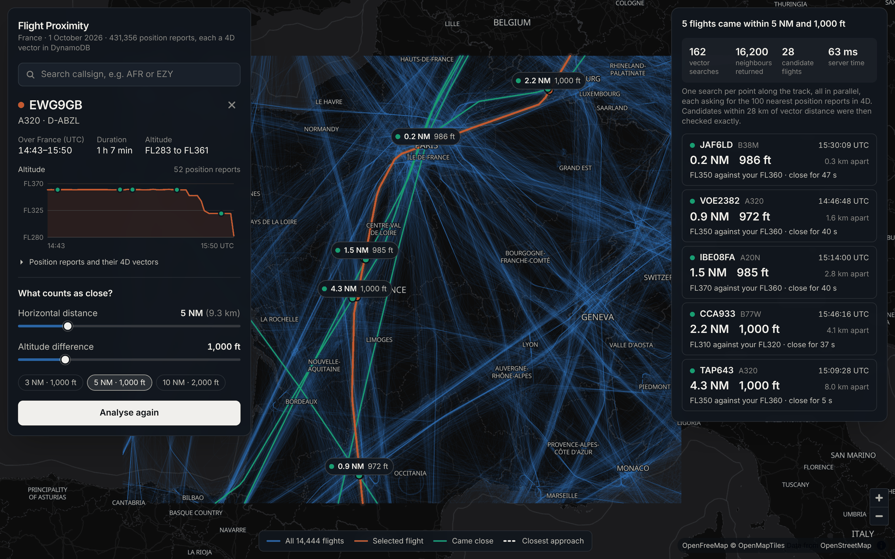
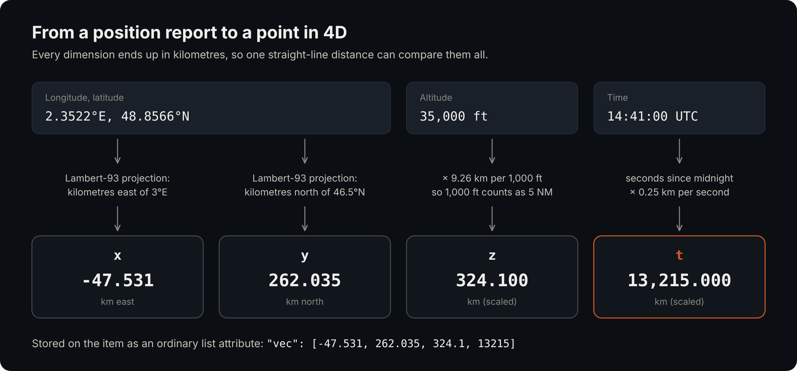
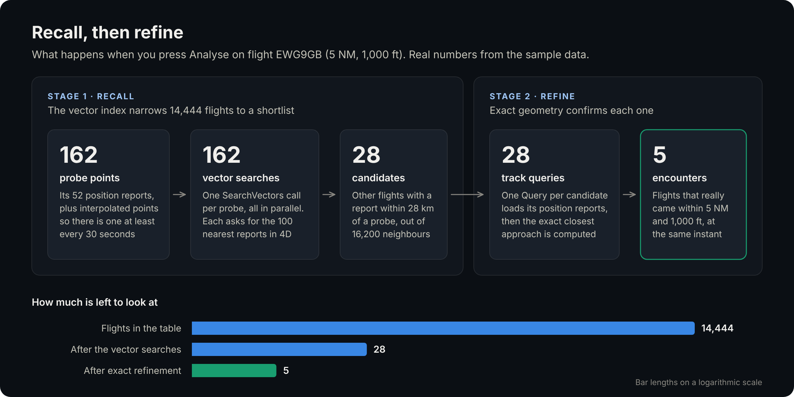
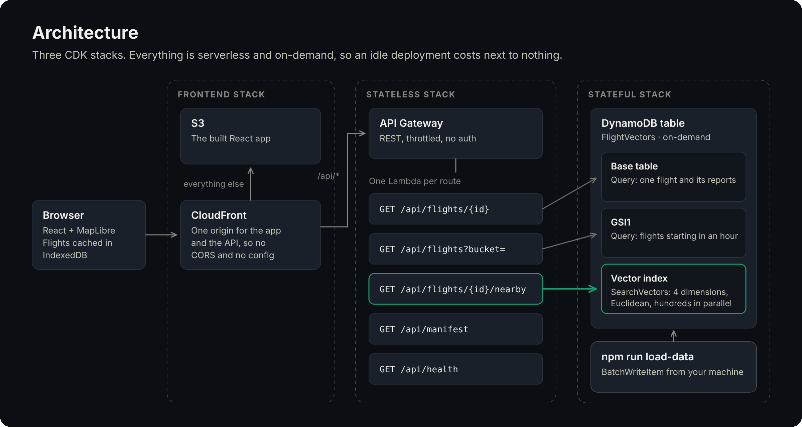
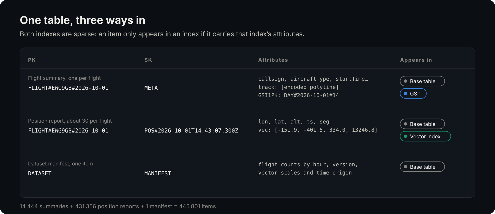

# Geospatial Search in Four Dimensions with DynamoDB Vector Indexes

A deployable example that uses a [DynamoDB vector index](https://docs.aws.amazon.com/amazondynamodb/latest/developerguide/VectorSearch.html) for something other than embeddings: finding aircraft that came close to each other in **x, y, z and time**.

It loads a day of air traffic over France (14,444 flights, 431,356 position reports) into DynamoDB, storing each position report as a four-dimensional vector. Pick a flight on the map, say what "close" means, and the application finds every other aircraft that came near it, in space and at the same moment.



_Screenshot taken with the application running locally (`npm run local-api`)._

There is a write-up of the approach, the trade-offs and the alternatives in [blog/geospatial-search-in-four-dimensions.md](blog/geospatial-search-in-four-dimensions.md).

## Contents

- [The idea](#the-idea)
- [How the search works](#how-the-search-works)
- [Try it locally](#try-it-locally)
- [Deploy to AWS](#deploy-to-aws)
- [Architecture](#architecture)
- [Data model](#data-model)
- [API](#api)
- [Evaluating recall](#evaluating-recall)
- [Project structure](#project-structure)
- [Commands](#commands)
- [Things to know about vector indexes](#things-to-know-about-vector-indexes)
- [Dependencies](#dependencies)

## The idea

A vector index finds the stored lists of numbers nearest to the one you give it. It is normally fed embeddings with a thousand or more dimensions, but it works just as well on four numbers you have chosen yourself.

Each position report is converted into `[x, y, z, t]`, with every dimension expressed in kilometres so that a single Euclidean distance can compare them:



| Dimension | From | Conversion | Why |
|---|---|---|---|
| `x`, `y` | Longitude, latitude | Lambert-93 projection, in km from the centre of France | Degrees are not distances |
| `z` | Altitude in feet | × 9.26 km per 1,000 ft | Aircraft are kept 5 NM apart horizontally or 1,000 ft vertically, so the two are made equal |
| `t` | Timestamp | Seconds since midnight × 0.25 km/s | A jet covers about 250 m a second, so a minute in time equals 15 km in space |

The scaling is where the domain knowledge lives: it decides what the index considers "near". The code is in [`src/geo/vector-space.ts`](src/geo/vector-space.ts).

## How the search works

Position reports arrive roughly once a minute and are not aligned between aircraft, so the nearest stored points are not the closest approach. The search therefore runs in two stages:



1. **Recall.** For every point along the selected flight (plus interpolated points, so there is one at least every 30 seconds), the Lambda calls `SearchVectors` for the 100 nearest position reports in 4D. All of the searches run in parallel. Any other flight with a report inside a generous radius becomes a candidate.
2. **Refine.** Each candidate's track is loaded with a `Query`, and the exact closest point of approach between the two tracks is computed. Only flights that really came within the chosen horizontal and vertical limits, at the same instant, are returned.

The code is in [`src/services/nearby-flights.ts`](src/services/nearby-flights.ts) and [`src/geo/closest-approach.ts`](src/geo/closest-approach.ts).

## Try it locally

You can run the whole application without an AWS account. The local API uses the same Lambda handlers, with the flight file loaded into memory and an exact nearest-neighbour scan standing in for the DynamoDB vector index.

Prerequisites: Node.js 22.13 or later (24 recommended).

```bash
npm ci
npm ci --prefix frontend
```

In one terminal, start the API on port 3001:

```bash
npm run local-api
```

In another, start the frontend:

```bash
npm run frontend
```

Open <http://localhost:5173>. Search for a callsign or click a track, set the limits and press **Analyse**. To jump straight to the flight in the screenshot, open <http://localhost:5173/?flight=EWG9GB%232026-10-01&h=5&v=1000&analyse=1>.

## Deploy to AWS

You will need AWS credentials for an account and region where DynamoDB vector indexes are available, and the account must be [bootstrapped for CDK](https://docs.aws.amazon.com/cdk/v2/guide/bootstrapping.html). The stacks deploy to whichever account and region your credentials point at.

**1. Deploy the three stacks.** This also builds the frontend.

```bash
npm ci
npm run deploy
```

Note the `SiteUrl` output of the frontend stack.

**2. Check that the vector index is ready.** A table can be `ACTIVE` while its vector index is still being created.

```bash
curl https://YOUR_SITE_URL/api/health
```

Wait until `vectorIndex.status` is `ACTIVE`. The endpoint returns 503 until data has been loaded as well.

**3. Load the flight data.** This writes 445,801 items and takes a few minutes. Writes are rate limited to stay within the initial capacity of a new on-demand table.

```bash
npm run load-data
```

Use `npm run load-data -- --limit 500` to load a small sample first, `--dry-run` to see what would be written, or `--table` and `--region` to target a different table. The index is updated asynchronously, so allow a moment after the load completes.

**4. Open the site** at the `SiteUrl`.

**5. Clean up** when you have finished. Everything, including the table, is removed.

```bash
npm run destroy
```

### Cost

All resources are on-demand, so an idle deployment costs very little. Loading the full dataset is roughly 446,000 write request units plus about 0.4 GB of vector index writes (each vector is billed at a 1 KB minimum), which comes to around fifty cents at us-east-1 prices at the time of writing. An analysis is a few hundred vector searches and costs a tiny fraction of a cent. Check the [DynamoDB pricing page](https://aws.amazon.com/dynamodb/pricing/) for your region.

The API has no authentication. It is read-only and throttled (20 requests a second by default, set in [`config/environment-config.ts`](config/environment-config.ts)), but do not leave it deployed longer than you need it.

## Architecture



| Stack | Contents |
|---|---|
| `FlightVectorsStatefulStack` | The DynamoDB table, a GSI for listing flights, and the four-dimensional vector index |
| `FlightVectorsStatelessStack` | API Gateway (REST) and one Lambda function per route |
| `FlightVectorsFrontendStack` | S3 and CloudFront. The distribution serves the React application and routes `/api/*` to API Gateway, so the browser sees a single origin |

Three points worth knowing if you are adding a vector index to your own CDK project:

- **The index is set on the L1 construct.** The L2 `Table` does not expose vector indexes yet, so [`lib/constructs/custom-table.ts`](lib/constructs/custom-table.ts) sets `CfnTable.vectorIndexes`.
- **Searching needs its own IAM action.** `table.grantReadData()` does not include `dynamodb:SearchVectors`. The same file has a `grantSearchVectors()` helper that grants it on the index ARN.
- **The AWS SDK is bundled with each function.** `SearchVectorsCommand` only exists in recent SDK releases, so [`lib/constructs/custom-lambda.ts`](lib/constructs/custom-lambda.ts) sets `bundleAwsSDK: true` rather than rely on the version in the Lambda runtime.

## Data model

One table, with a partition key `PK` and sort key `SK`:



| Item | PK | SK | Indexed by |
|---|---|---|---|
| Flight summary | `FLIGHT#<callsign>#<date>` | `META` | `GSI1`, by the UTC hour the flight starts |
| Position report | `FLIGHT#<callsign>#<date>` | `POS#<ISO timestamp>` | Vector index `position-4d`, on the `vec` attribute |
| Dataset manifest | `DATASET` | `MANIFEST` | |

A flight is identified by its callsign and date. Around 9% of callsigns are used more than once in a day, so the second and later flights get a `#2`, `#3` suffix in order of departure. Aircraft with no callsign are identified by their ICAO address.

Both indexes are sparse. Only flight summaries carry `GSI1PK`, and only position reports carry `vec`, so each index holds exactly one kind of item. The manifest records the scales used to build the vectors, and the API reads them back so that query vectors are always encoded the same way as the stored ones.

## API

| Route | Returns | DynamoDB access |
|---|---|---|
| `GET /api/health` | Table and vector index status | `DescribeTable` |
| `GET /api/manifest` | The loaded dataset: counts, hourly buckets, version, vector scales | `GetItem` |
| `GET /api/flights?bucket=HH` | Summaries of the flights starting in a UTC hour, each with an encoded track | `Query` on `GSI1` |
| `GET /api/flights/{flightId}` | One flight with its position reports and their vectors | `Query` |
| `GET /api/flights/{flightId}/nearby?horizontalNm=5&verticalFt=1000` | Flights that came within the limits, with the closest approach for each, and statistics on how the search ran | `SearchVectors` per probe point, then `Query` per candidate |

Flight ids contain `#`, so encode them in URLs: `EWG9GB%232026-10-01`. `horizontalNm` accepts 0.1 to 20 and `verticalFt` accepts 0 to 5,000.

The browser fetches all 24 hourly buckets in parallel on first load and caches the result in IndexedDB, keyed by the manifest's `version`. Reloading the data changes the version and invalidates the cache.

## Evaluating recall

`npm run evaluate` measures how well the two-stage search finds real encounters. For a sample of flights it computes the true answer by brute force (every flight against every other flight), runs the search, and compares the two.

It runs against the exact in-memory search, not DynamoDB. To stand in for an approximate index, 5% of the neighbours each search should return are dropped at random.

Share of true encounters found, for 1,000 sampled flights:

| Limits | True encounters | TopK 10 | TopK 20 | TopK 50 | TopK 100 |
|---|---:|---:|---:|---:|---:|
| 3 NM / 1,000 ft | 517 | 100% | 100% | 100% | 100% |
| 5 NM / 1,000 ft | 1,002 | 100% | 100% | 100% | 100% |
| 5 NM / 2,000 ft | 1,701 | 100% | 100% | 100% | 100% |
| 10 NM / 2,000 ft | 4,346 | 99.7% | 100% | 100% | 100% |
| 20 NM / 5,000 ft | 17,238 | 82.1% | 94.5% | 99.7% | 100% |

The application uses TopK 100, the maximum DynamoDB allows. Reproduce the table, along with comparisons of the time scale and probe spacing, with:

```bash
npm run evaluate -- --flights 1000 --sweep
```

The sweep takes around ten minutes. Without `--sweep` it evaluates the default settings only.

## Project structure

```text
├── bin/app.ts                    # CDK app: the three stacks
├── config/                       # Region, table name, API throttling
├── lib/
│   ├── constructs/               # CustomTable (with vector indexes), CustomLambda
│   ├── stateful/                 # Table, GSI and vector index
│   ├── stateless/                # API Gateway and Lambda functions
│   └── frontend/                 # S3 and CloudFront
├── src/
│   ├── api/                      # One Lambda handler per route
│   ├── geo/                      # Projection, vector encoding, closest approach, polylines
│   ├── ingest/                   # Reading the flight file into flights
│   ├── services/                 # The two-stage nearby-flights search
│   └── store/                    # Key design, item builders, DynamoDB and in-memory stores
├── scripts/
│   ├── load-flights.ts           # Loads the data into DynamoDB
│   ├── local-api.ts              # Runs the API locally, without AWS
│   └── evaluate-recall.ts        # Measures recall against brute force
├── test/                         # Fixtures, brute-force ground truth, recall test on the real data
├── data/                         # One day of flights over France, as NDJSON
├── frontend/                     # React and MapLibre application
└── blog/                         # The write-up and its figures (SVG and PNG)
```

## Commands

| Command | Description |
|---|---|
| `npm run local-api` | Serve the API from memory on port 3001 |
| `npm run frontend` | Start the frontend dev server on port 5173 |
| `npm run deploy` | Deploy all three stacks |
| `npm run load-data` | Load the flight data into DynamoDB |
| `npm run destroy` | Remove all three stacks |
| `npm run evaluate` | Measure search recall against brute force |
| `npm test` | Run the unit tests, including a recall check on the real data |
| `npm run build` | Type-check the infrastructure, Lambda code and scripts |
| `npm run lint` | Run ESLint |
| `npm run synth` | Synthesise the CloudFormation templates |

Synthesis and the tests need no AWS credentials. For a synth without credentials, give CDK a placeholder account:

```bash
CDK_DEFAULT_ACCOUNT=123456789012 CDK_DEFAULT_REGION=eu-west-1 npm run synth
```

The frontend has its own `npm run build` and `npm run lint`; see [frontend/README.md](frontend/README.md).

## Things to know about vector indexes

- **On-demand tables only.** Provisioned capacity is not supported.
- **At most 100 results per search.** With wide limits in dense airspace, the neighbours you need may not all fit. The evaluation above shows where that begins to matter.
- **Filters are equality only.** There are no range conditions and no "not equal", which is why each search also returns the selected flight's own reports and the code discards them.
- **Approximate and eventually consistent.** The index is updated asynchronously after a write, and a search may not return exactly the nearest items.
- **The distance function and dimensions are permanent.** Changing either means creating a new index.
- **"Near" is fixed when you write.** The altitude and time scales are baked into the stored vectors. The limits in the UI change how results are filtered, not what the index considers close.
- **Values are stored as 32-bit floats.** About seven significant digits, which is why time is measured from midnight and positions from the centre of France.
- **Only projected attributes can be returned** by a search. This project projects everything.

## Dependencies

Both projects carry an `.npmrc` with `min-release-age=2`, so that npm 11.17 and later will only select package versions published at least two days earlier. Dependencies are at the newest versions that satisfied that window when they were last updated. `npm ci` installs exactly what is in the lockfiles on any npm version.

TypeScript stays on 6.0.x. TypeScript 7 does not yet work with typescript-eslint (which requires `<6.1.0`) or ts-jest (`<7`).

`npm audit` reports moderate advisories in transitive dependencies of the test and lint tooling (`glob`, `minimatch`, `deepmerge`), for which no compatible fixed versions exist yet. They are development tools and are not part of the deployed Lambda code or the frontend bundle.
