<!--
Before publishing:
- dev.to needs absolute image URLs. Replace "./images/" with
  "https://raw.githubusercontent.com/Crockwell-Solutions/cdk-geospatial-dynamodb-vectors/main/blog/images/"
- The recall figures come from `npm run evaluate`, which uses an exact in-memory search. They are real, but
  they are not measurements of DynamoDB. Two places below are marked TODO for numbers from a deployed stack.
- Check the prices in "What It Costs" against the DynamoDB pricing page for your region.
-->

Vector indexes arrived in DynamoDB to store embeddings: 1,024 numbers that a model has decided represent the meaning of a sentence. But a vector index has no idea what its numbers mean. It finds the stored lists of numbers nearest to the one you give it, and that is all.

So what happens if you give it four numbers that you chose yourself: **x, y, z and time**?

This post takes a day of air traffic over France, 14,444 flights and 431,356 position reports, and answers a question that DynamoDB has never been good at: *which aircraft came close to this one, in both space and time?*

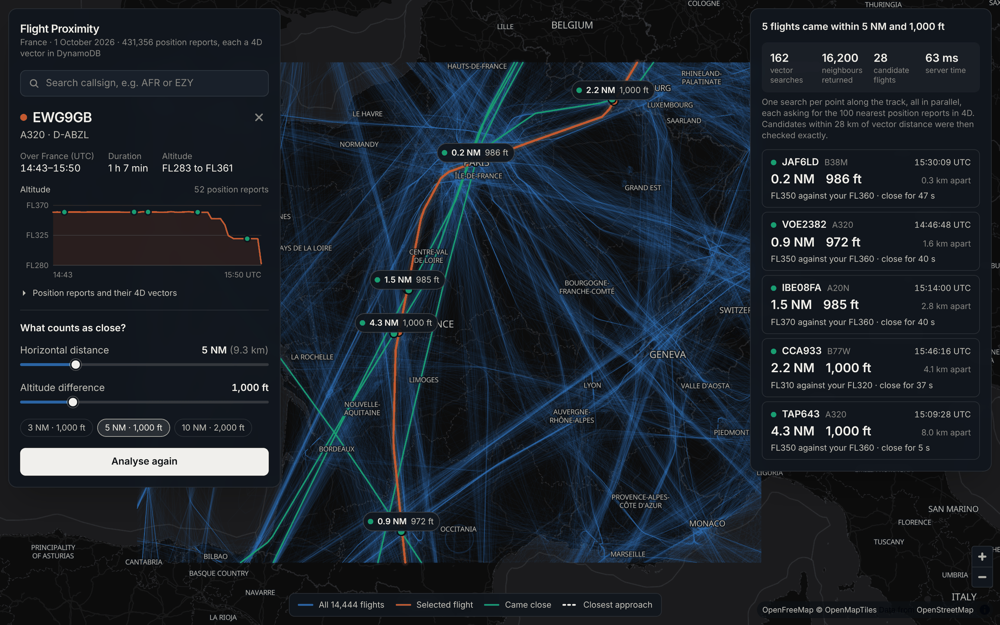

Everything here is in a deployable CDK project: [cdk-geospatial-dynamodb-vectors](https://github.com/Crockwell-Solutions/cdk-geospatial-dynamodb-vectors).

## Where This Picks Up

Last year I wrote about [effective handling of geospatial data in DynamoDB](https://dev.to/ianbrumby/effective-handling-of-geospatial-data-in-dynamodb-1hmn). The approach there was geohashes at several precisions, spread across the partition key and a GSI, so that a bounding box could be queried at the right level of detail. It works, and it is still what I would reach for when the question is "what is in this area?".

It is much less comfortable when the question is "what is *nearest* to this?", and I left nearest-neighbour queries on the to-do list at the end of that post.

Now add altitude. Then add time. To find aircraft near a flight with hashes you would need a geohash, an altitude band and a time bucket, then query every combination the flight passes through, plus the neighbouring cells, bands and buckets in case something was sitting just the other side of a boundary. Then throw most of it away.

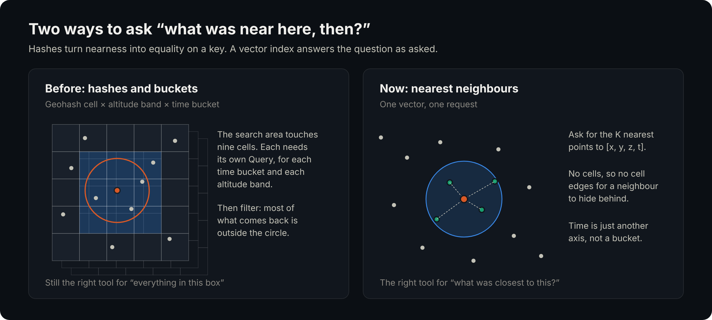

A vector index answers the question as asked. [DynamoDB vector search](https://docs.aws.amazon.com/amazondynamodb/latest/developerguide/VectorSearch.html) went generally available in August 2026, and the old approach is still correct, but for this kind of problem there is now a better tool in the same database.

## Vectors Without Embeddings

I am not the first to notice that the numbers don't have to be embeddings. Martin Hicks wrote a nice piece on [DynamoDB vector search without embeddings](https://dev.to/martinhicks/dynamodb-vector-search-without-embeddings-5m2), projecting latitude and longitude onto a sphere to find the nearest shop. This post pushes the same idea two dimensions further, to things that move.

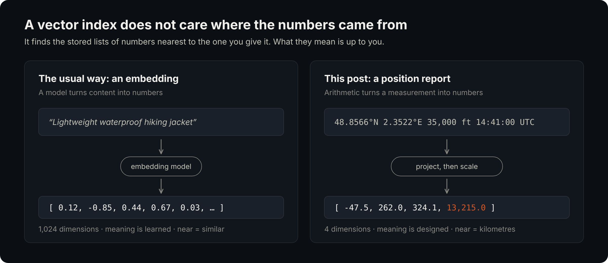

The difference matters. With an embedding, the model decides what "near" means and you trust it. With a handmade vector, **you** decide what "near" means, and the index will faithfully do whatever you told it, sensible or not.

Most of the work in this project went into that decision.

## Designing the Vector Space

A position report in the source data looks like this: longitude, latitude, altitude in feet and a timestamp. Four numbers already. Why not index them as they are?

Because a Euclidean index treats every dimension the same. It would consider one degree of longitude, one degree of latitude, one foot and one second to be equal distances. An aircraft 500 ft above you would look 500 times further away than one a full degree of latitude (111 km) to the north.

Every dimension has to be converted into the same unit, and I chose kilometres.

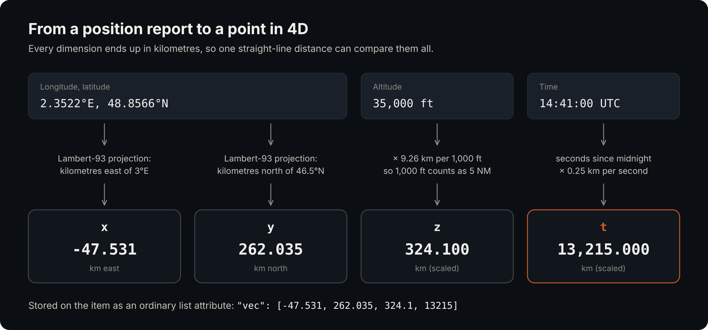

### x and y: a flat grid

Degrees are not distances. Over France a degree of longitude is about 70 km and a degree of latitude about 111 km, and the ratio changes as you move north.

The fix is a map projection. I used Lambert-93, the official projection for metropolitan France, which keeps distances true to within half a percent across the whole dataset. It is about 25 lines of arithmetic with no dependencies. For data that spans the globe you would use earth-centred (ECEF) coordinates instead.

### z: stretching altitude

Altitude in kilometres would be honest, and wrong. Controllers keep aircraft either 5 nautical miles apart horizontally or 1,000 ft apart vertically. In real kilometres those are 9.26 km and 0.3 km. An index working in true scale would rank an aircraft 1,000 ft directly above you, which is perfectly normal, as far closer than one 3 NM away at your level, which is not.

So altitude is stretched until 1,000 ft is worth exactly 5 NM.

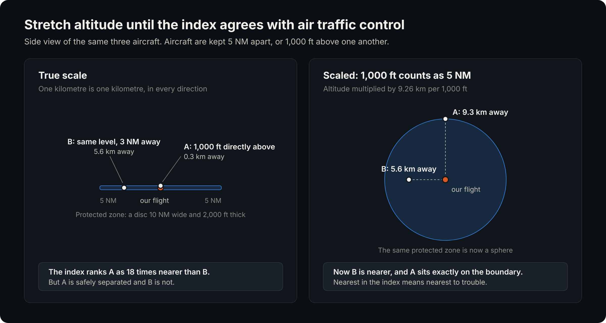

This is the single most useful trick in the project. The protected zone around an aircraft is a flat disc. After scaling it is a sphere, and spheres are what a Euclidean index searches.

### t: an exchange rate for time

Time needs converting into distance too, and the natural rate is the speed of the thing being tracked. A jet covers roughly 250 m every second.

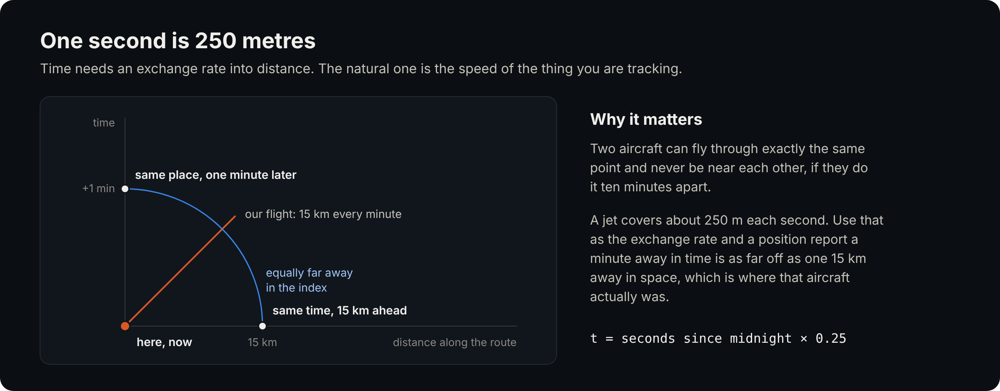

Use that, and "the same place one minute later" is as far away as "15 km ahead right now", which is where that aircraft actually was.

One practical detail: time is measured from midnight, not as epoch seconds. The index stores each number as a 32-bit float, which holds about seven significant digits. An epoch timestamp like 1,790,812,800 would be rounded to the nearest two minutes, and the time dimension would be useless.

The whole encoding is one small function:

```typescript
export function toVector(space: VectorSpace, point: FourDPoint): Vector4 {
  const { x, y } = projectToKm(point.lon, point.lat);
  return [
    round3(x),
    round3(y),
    round3(point.alt * space.kmPerFoot), // 9.26 km per 1,000 ft
    round3((point.ts - space.epochSeconds) * space.kmPerSecond), // 0.25 km per second
  ];
}
```

The scales are stored in DynamoDB alongside the data and read back at query time. A query vector built with different scales from the stored ones would search a different space entirely, and nothing would tell you.

### Why Euclidean

DynamoDB offers three distance functions: `COSINE`, `EUCLIDEAN` and `DOT_PRODUCT`. For this there is only one candidate.

Cosine compares direction from the origin and ignores length. Two aircraft on the same bearing from the centre of France, 50 km and 500 km out, would be "identical". Dot product rewards large values, so it would favour whatever was furthest from the origin. Only Euclidean distance means separation. The choice is permanent, incidentally: the distance function cannot be changed after the index is created.

## The Table

One table holds everything. A flight is identified by its callsign and date, and each position report sits under it with the timestamp as the sort key.

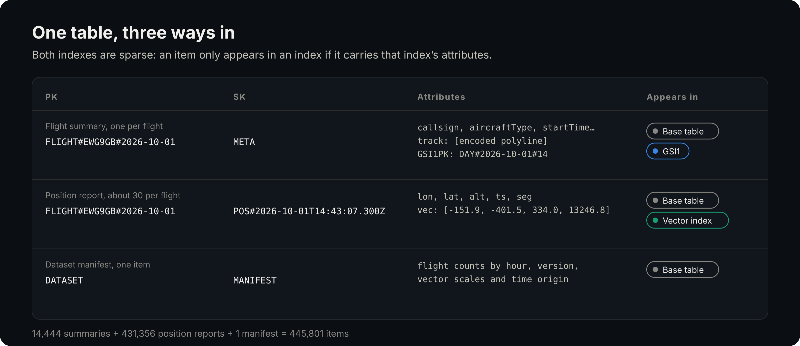

Two things made this simpler than I expected:

- **The vector is just an attribute.** `vec` is an ordinary DynamoDB list of four numbers, written with an ordinary `BatchWriteItem`. There is no separate API for writing vectors.
- **The index is sparse.** Only items that have a `vec` attribute are indexed. Flight summaries live in the same table and stay out of the index, exactly as they stay out of each other's way in a sparse GSI.

One wrinkle in the data: I assumed callsign and date would identify a flight. About 9% of callsigns turn out to be used more than once in a day, mostly an aircraft flying several legs, so later flights get a `#2`, `#3` suffix.

### Adding the index in CDK

The L2 `Table` construct does not expose vector indexes yet, but the L1 `CfnTable` does, so it is a short escape hatch:

```typescript
const cfnTable = table.node.defaultChild as CfnTable;
cfnTable.vectorIndexes = [
  {
    indexName: 'position-4d',
    vectorAttribute: { attributeName: 'vec' },
    dimensions: 4,
    distanceFunction: 'EUCLIDEAN',
    projection: { projectionType: 'ALL' },
  },
];
```

Three things caught me out, or would have:

1. **Vector indexes need on-demand billing.** Provisioned tables are not supported.
2. **`grantReadData` is not enough.** Searching has its own IAM action, `dynamodb:SearchVectors`, scoped to the index ARN:

   ```typescript
   Grant.addToPrincipal({
     grantee: findNearbyFlights,
     actions: ['dynamodb:SearchVectors'],
     resourceArns: [`${table.tableArn}/index/position-4d`],
   });
   ```

3. **Bundle the SDK.** `SearchVectorsCommand` only exists in recent releases of the AWS SDK. `NodejsFunction` leaves the SDK out of the bundle by default and uses whatever the Lambda runtime ships, so I set `bundleAwsSDK: true` rather than find out which version that is.

## Searching

A search takes a vector and a number, and returns that many of the nearest items:

```typescript
const response = await client.send(
  new SearchVectorsCommand({
    TableName: tableName,
    IndexName: 'position-4d',
    SearchVector: [x, y, z, t],
    TopK: 100,
    ProjectionExpression: '#pk, #lon, #lat, #alt, #ts',
    ExpressionAttributeNames: { '#pk': 'PK', '#lon': 'lon', '#lat': 'lat', '#alt': 'alt', '#ts': 'ts' },
  }),
);
```

That finds what was near *one point*. A flight is a line through space and time, so the Lambda runs one search for every point along it, all in parallel:

```typescript
await mapWithConcurrency(probes, 48, async (probe) => {
  const vector = toVector(space, probe);
  const { hits } = await store.searchPositions(vector, topK);
  for (const hit of hits) {
    const distanceKm = vectorDistance(vector, toVector(space, hit.position));
    if (distanceKm > radiusKm || hit.flightId === ownFlightId) continue;
    best.set(hit.flightId, Math.min(best.get(hit.flightId) ?? Infinity, distanceKm));
  }
});
```

Doing the fan-out inside one Lambda, rather than one API call per point from the browser, keeps it to a single round trip and lets the function reuse its connections.

Every search also returns the flight's own position reports, since nothing is nearer to a flight than itself. Filters on a vector index only support equality, so there is no way to say "not this flight". They are simply dropped in code.

## The Catch: Position Reports Are Sparse

If the data had a position for every aircraft every second, that would be the end of it. It doesn't. Reports arrive roughly once a minute, and each aircraft's reports fall at different moments.

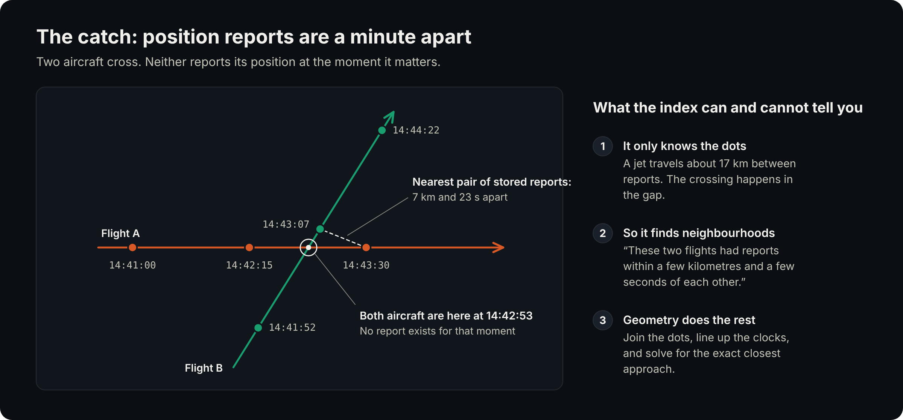

A jet travels about 17 km between reports. Two aircraft can pass within a few hundred metres of each other while their nearest *stored* points are several kilometres and twenty seconds apart. Take the index at its word and you would both miss real encounters and misreport the ones you found.

The answer is the same pattern used with any approximate index: **recall, then refine**.

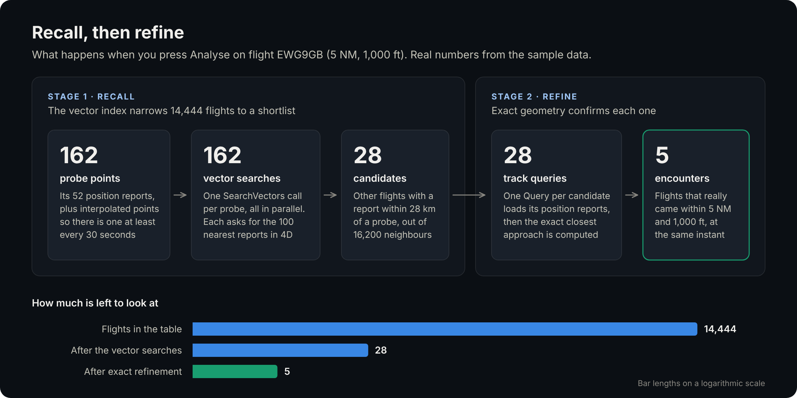

**Recall.** The vector searches are run with a generous radius, enough to cover the limits the user asked for plus the uncertainty from sparse reports. Any other flight with a report inside that radius is a candidate. Points are also interpolated along the selected flight so there is a search at least every 30 seconds.

**Refine.** For each candidate, one `Query` loads its position reports. Both tracks are treated as straight lines between reports, the clocks are lined up, and the exact closest point of approach falls out of a quadratic. No sampling and no time step, just the moment the two aircraft were closest and how far apart they were.

The index does what indexes are good at, turning 14,444 flights into a shortlist of a few dozen. A little geometry gives the actual answer.

For the flight in the screenshot above, 162 searches returned 16,200 neighbours, which came down to 28 candidate flights, of which 5 really were within 5 NM and 1,000 ft.

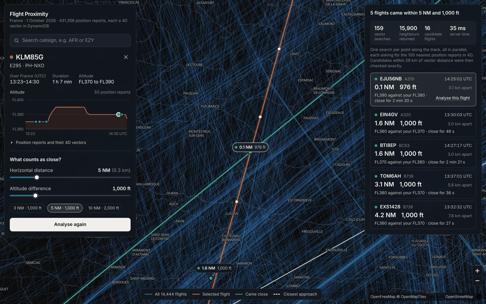

There is a pleasing sanity check in the results. Around four in five of the encounters the application finds at these limits have a vertical separation between 900 and 1,000 ft. That is not a coincidence. It is air traffic control doing its job, crossing aircraft exactly one level apart, and seeing it come out of the data is good evidence the maths is right.

<!-- TODO: add the measured Lambda duration and billed vector search bytes for this flight from a deployed stack. -->

## Does It Actually Find Everything?

An approximate index with a hard limit of 100 results per search, pointed at data it was never designed for. It would be reasonable to doubt it.

So I measured it. For a sample of 1,000 flights I compared each one against every other flight in the dataset by brute force, giving the true list of encounters. Then I ran the two-stage search and counted how many of the true encounters it found. The project includes the script (`npm run evaluate`).

One caveat: this runs against an exact in-memory search rather than DynamoDB itself. To stand in for the approximate index, 5% of the neighbours each search should have returned were thrown away at random.

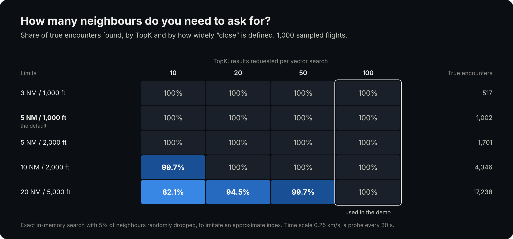

| Limits | True encounters | TopK 10 | TopK 20 | TopK 50 | TopK 100 |
|---|---:|---:|---:|---:|---:|
| 3 NM / 1,000 ft | 517 | 100% | 100% | 100% | 100% |
| 5 NM / 1,000 ft | 1,002 | 100% | 100% | 100% | 100% |
| 5 NM / 2,000 ft | 1,701 | 100% | 100% | 100% | 100% |
| 10 NM / 2,000 ft | 4,346 | 99.7% | 100% | 100% | 100% |
| 20 NM / 5,000 ft | 17,238 | 82.1% | 94.5% | 99.7% | 100% |

With `TopK` at its maximum of 100, every encounter was found at every setting, even with 5% of neighbours missing. That resilience comes from redundancy: each real encounter is seen by several searches along the track, so losing a neighbour from one of them rarely matters.

The bottom row is the one to learn from. The wider you define "close", the more position reports fall inside the search radius, until they no longer fit in 100 results and the furthest ones are cut off.

### Was 250 m per second the right exchange rate?

I picked the time scale because it made physical sense. The same evaluation shows it was also a good choice.

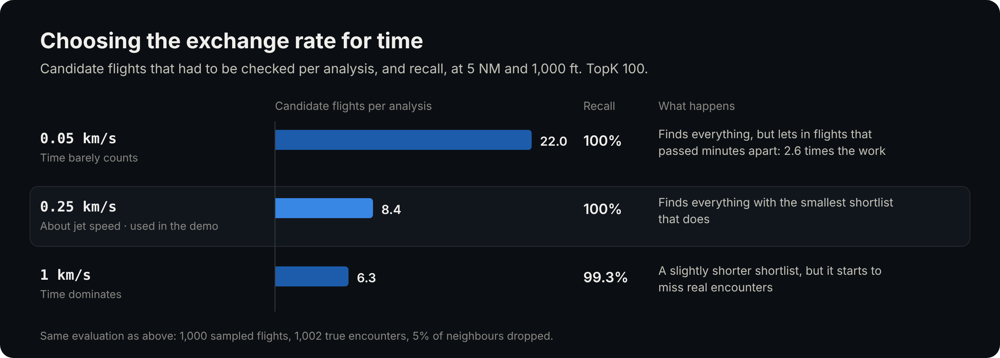

Make time count for too little and the search fills up with aircraft that passed through the same sky minutes earlier. Make it count for too much and reports a few seconds apart look far away, so real encounters start to slip through. Somewhere near the true speed of the aircraft is the sweet spot, which is a reassuring result.

## The Application

The frontend is React with MapLibre, served with the API from one CloudFront distribution.

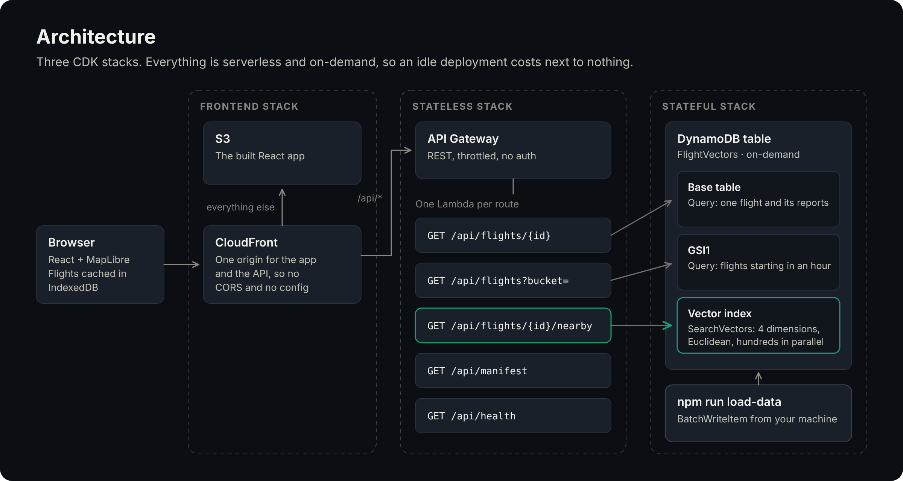

Drawing 14,444 tracks means fetching them first. Flight summaries carry their track as an encoded polyline and are listed through a GSI keyed by the hour the flight started, so the browser fetches 24 buckets in parallel behind a loading screen. The result goes into IndexedDB, keyed by a version from the dataset manifest, so later visits skip the download entirely.

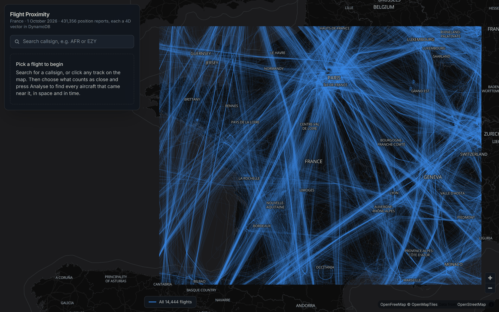

From there you search for a callsign or click a track, set what "close" means with two sliders, and press Analyse.

## What It Costs

Very little. Vector indexes are billed on bytes written, bytes processed by searches and bytes stored, with a 1 KB minimum per write and per search. At the us-east-1 prices at the time of writing:

- **Loading the data.** 445,801 items is about 446,000 write request units, roughly $0.28. The 431,356 vectors are each billed at the 1 KB minimum: 0.41 GB at $0.52 per GB is about $0.21.
- **Storage.** A few cents a month for the table and the index together.
- **An analysis.** A couple of hundred searches returning a few kilobytes each, at $0.002 per GB. Far less than the Lambda invocation that runs them.

Check the [pricing page](https://aws.amazon.com/dynamodb/pricing/) for your region before relying on these. The point is the order of magnitude: the whole demo loads for about fifty cents and idles for nearly nothing.

<!-- TODO: replace with the actual figures from Cost Explorer after a real load. -->

## What to Know Before You Copy This

**You choose "near" when you write, not when you query.** The altitude and time scales are baked into every stored vector. The sliders in the application change how results are filtered afterwards, but the index itself has one fixed idea of distance. A different idea means a second index on a second attribute.

**100 results is a hard ceiling.** In dense data with a wide search, the neighbours you need may not fit. The evaluation above shows where that starts to bite for this dataset.

**Filters are equality only.** No ranges and no "not equal". An index can have one partition key and some inline filters, all matched exactly. For data spanning many days, partitioning the index by date would be the natural next step, and it would keep the time values small enough for 32-bit floats as well.

**It is approximate and eventually consistent.** The index is updated asynchronously after a write, and searches may not return exactly the nearest items. Design for both, as the refine step here does.

**Readiness is separate from the table.** A table can be `ACTIVE` while its vector index is still being built, and there is no SDK waiter for it. The project has a health endpoint that reports the index status for this reason.

**The index knows points, not paths.** Anything that happens between your stored points, the index cannot see. If your data is sparse relative to how fast things move, you need a refine step.

## Alternatives

DynamoDB was the interesting answer here, not the only one.

### PostGIS

If you asked a GIS engineer to solve this, they would use PostGIS, and with good reason. It has this exact problem built in. Store each flight as a single 4D line, where the fourth ordinate is time, and there are functions for the closest point of approach between two trajectories:

```sql
-- Each flight is one LINESTRING ZM in Lambert-93 metres, with M as epoch seconds
SELECT other.callsign,
       ST_DistanceCPA(own.track, other.track) AS metres_apart,
       to_timestamp(ST_ClosestPointOfApproach(own.track, other.track)) AS closest_at
FROM   flights own
JOIN   flights other ON other.flight_id <> own.flight_id
WHERE  own.flight_id = 'EWG9GB#2026-10-01'
  AND  ST_CPAWithin(own.track, other.track, 9260) -- 5 NM in metres
ORDER  BY metres_apart;
```

I have not run this against the dataset, so treat it as a sketch, but the functions are real and they do in one statement what took me a vector index and a page of geometry. An n-dimensional GiST index on the tracks keeps it fast.

It differs from the DynamoDB approach in a few ways that matter:

- **It is exact.** No recall stage, no radius to tune and no result limit.
- **It works on paths, not points.** The sparse reporting problem disappears, because the database interpolates along the line for you.
- **It is one distance.** `ST_DistanceCPA` returns a single 3D figure, so separate horizontal and vertical limits still need the altitude stretch, or a second calculation.
- **It is a database server.** Something has to be running, patched and connected to. Aurora Serverless softens that, but a Lambda talking to PostgreSQL means VPCs or the Data API, connection management and a cold start measured in seconds if you let it pause.

If I were building an analysis tool for a team that already ran PostgreSQL, I would use PostGIS without a second thought.

### Geohashes in DynamoDB

The approach from [my earlier post](https://dev.to/ianbrumby/effective-handling-of-geospatial-data-in-dynamodb-1hmn) is still the right one for area queries: everything in a bounding box, at a chosen precision, with predictable cost and exact results. It struggles here because every extra dimension multiplies the number of cells to query.

### No index at all

It is worth being honest about scale. One day over France is 431,356 points. Held in memory, a brute-force comparison of one flight against all the others takes a few milliseconds. A Lambda that loaded the day from S3 would answer this question perfectly well.

The index earns its place when the data does not fit in memory, when it is being written continuously, or when it already lives in DynamoDB for other reasons. A year of European traffic is a different problem from a day over France.

### How they compare

| | DynamoDB vector index | PostGIS | DynamoDB geohash GSIs |
|---|---|---|---|
| Nearest neighbour | Built in, approximate | Built in, exact | Awkward |
| Closest approach between tracks | In your own code | Built in | In your own code |
| Bounding-box queries | No | Yes | Yes |
| Range filters | No, equality only | Yes | On the sort key |
| Infrastructure | None to run | A database | None to run |
| Scales by | Itself | Instance size | Itself |
| Cost when idle | Storage only | Depends on pausing | Storage only |
| Best when | The data is already in DynamoDB and you want nearest neighbours | You need real spatial analysis | You need area queries at scale |

I also looked at the wider set of options in [Serverless Vector Stores on AWS](https://dev.to/ianbrumby/serverless-vector-stores-on-aws-5800), if you are choosing between them for more conventional vector workloads.

## Wrapping Up

I expected this to be a novelty: a neat trick that fell over on real data. It held up better than that.

The vector index did not solve the problem on its own. It could not, because it sees points and the problem is about paths. What it did was remove the hard part, the part that used to need several hashes and a lot of iteration, and leave behind some geometry that fits in a single file.

The lesson I would take to other problems is that a vector index is a general-purpose nearest-neighbour engine, and the embeddings are optional. If you can express "similar" as a handful of numbers on comparable scales, whether that is position and time, or price and size and age, DynamoDB can now search it. The thinking goes into the scales.

The full project, including the data, the loader, the evaluation script and the map application, is on GitHub: [cdk-geospatial-dynamodb-vectors](https://github.com/Crockwell-Solutions/cdk-geospatial-dynamodb-vectors). You can run the whole thing locally without an AWS account, or deploy it with `cdk deploy`.
